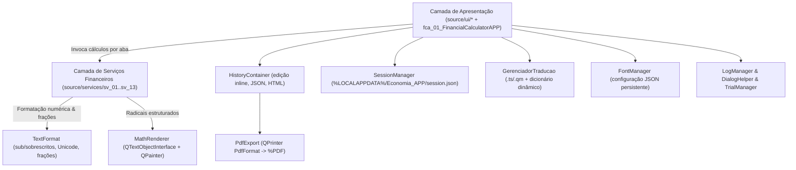

# Arquitetura Técnica — Economia_APP (`C++23` + `Qt 6.12.0`)

**Versão:** `2026.11.22.0` | **Data:** `22 de novembro de 2026`  
**Version:** `2026.11.22.0` | **Date:** `November 22, 2026`

[🇺🇸 English version below](#-technical-architecture--economia_app-c23--qt-6120)

## 🇧🇷 Visão Geral de Engenharia

O **Economia_APP** é uma aplicação desktop nativa em **C++23** com **Qt 6.12.0 Widgets**, estruturada em camadas desacopladas para cálculo de Engenharia Econômica, Matemática Financeira, renderização matemática vetorial nativa (`QPainter` via `QTextObjectInterface`), persistência local de sessões e geração de relatórios em PDF via `Qt6::PrintSupport`.

- **Idioma padrão de runtime**: Português do Brasil (`pt_BR`), com alternância dinâmica para Inglês (`en_US`) via `GerenciadorTraducao` e arquivos `.qm`.
- **Plataforma alvo**: Windows 10/11 x64 (`0x8664`), sem dependências externas obrigatórias além do Qt6 e do runtime nativo da respectiva cadeia de compilação (MSVC ou MinGW).
- **Ferramentas de build suportadas**:
  - **MSVC puro**: `Visual Studio 18 2026` MSBuild (`x64`, toolset `v145,host=x64,version=14.52.37025`, Windows SDK `10.0.28000.0`, C++23 `/std:c++latest` `/permissive-`).
  - **MinGW-w64**: `MinGW Makefiles` (`GCC 15.1.0`, `-std=c++23`).

### Diagrama de Camadas

### Estrutura Modular do Repositório

| Diretório | Responsabilidade | Principais Componentes |
|---|---|---|
| `source/fca_01_FinancialCalculatorAPP.*` | Janela principal (`QMainWindow`), coordenação das 12 abas e slots de ação | `FinancialCalculatorApp` |
| `source/services/` | Regras de negócio financeiras (`sv_01` a `sv_13`) | Juros, Anuidades, Gradientes, Taxas, Amortização, Investimentos, Depreciação, Taxa Efetiva/TIR/TIRm, Retorno Mínimo, Fisher, VPL c/ Impostos, CAUE |
| `source/ui/` | Criação das 12 abas (`ui_03`..`ui_14`), tabelas (`ui_15`..`ui_22`), histórico (`ui_23`), fontes (`ui_24`), PDF (`ui_25`), menu (`ui_26`), Sobre (`ui_27`..`ui_29`) e Manual (`ui_30`..`ui_33`) | `HistoryContainer`, `SobreDialog`, `Manual` |
| `source/utils/` | Utilitários transversais e camada matemática/persistência | `MathRenderer`, `TextFormat`, `FontManager`, `SessionManager`, `LogManager`, `IconUtils`, `ApplicationPathUtils` |
| `source/language/` | Gerenciamento de tradução e compilação `.ts` -> `.qm` | `GerenciadorTraducao` |
| `mocks/` | Utilitários auxiliares de build e sincronização de versão | `find_VersionEditor`, `CompileTranslationsTerminal`, `limpar_build_qt6_regeneravel.ps1` |
| `tests/` | Suíte profissional de 10 conjuntos automatizados `Qt6::Test` / `CTest` | `test_01` .. `test_10`, `TestSupport.hpp` |
| `library/` | Manifestos do Inno Setup 7 (MSVC e MinGW sem `vc_redist.x64.exe`), `AppxManifest.xml` e notas | `Economia_APP.iss`, `Economia_APP_MSVC.iss`, `Economia_APP_MinGW.iss`, `AppxManifest.xml`, `Economia_APP_cpp.txt` |
| `images/interfaces/` | Capturas de tela oficiais da interface gráfica em Português (`pt_BR`) e Inglês (`en_US`) | 14 capturas em `pt_BR/` e `en_US/` |

---

## 🇺🇸 Technical Architecture — Economia_APP (`C++23` + `Qt 6.12.0`)

**Economia_APP** is a native **C++23** desktop application built with **Qt 6.12.0 Widgets**, cleanly separated into presentation (`source/ui/`), domain financial engines (`source/services/`), native vector math rendering (`MathRenderer`), local session persistence (`SessionManager`), and offline PDF export (`Qt6::PrintSupport`).

- **Toolchains**: Pure **MSVC** (`Visual Studio 18 2026` MSBuild x64, `v145`, Windows SDK `10.0.28000.0`) and **MinGW-w64** (`GCC 15.1.0`, `-std=c++23`), both strictly isolated at compile, link, and runtime deployment stages.
- **Core Pipeline**: User inputs validated via `QDoubleValidator` / `get_float_from_line_edit` feed 13 financial services that emit step-by-step derivations formatted through `TextFormat` and `MathRenderer`, persisted in `HistoryContainer`, restorable via `SessionManager`, and printable cleanly to `%PDF` documents without any network access.
